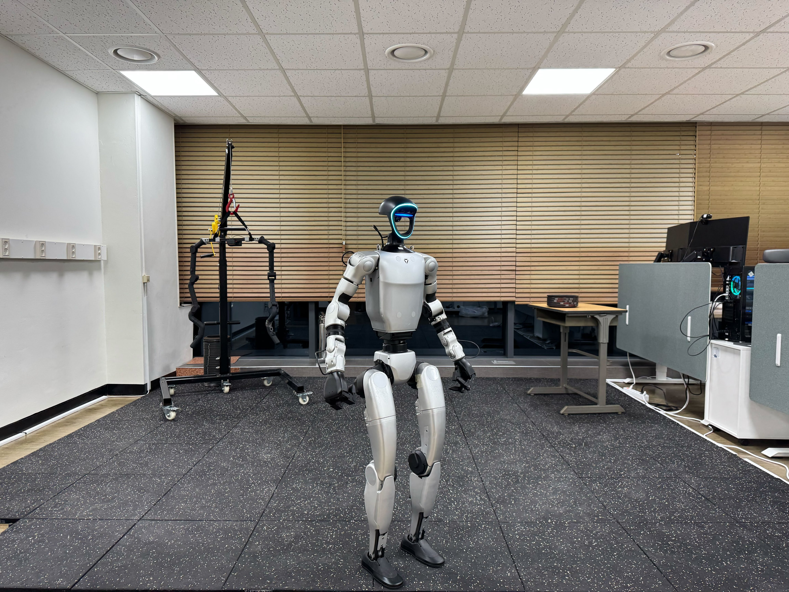
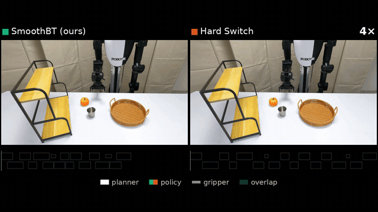
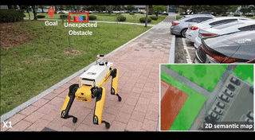

  <section class="intern-hero">
    
KAIST · RIRO Lab · Undergraduate Research

    <h1>Build robots that learn, reason, and act.</h1>
    
We welcome undergraduate students who want to pursue <strong>long-term graduate research in robotics and robot learning</strong> at RIRO Lab. Our research internships offer hands-on involvement in ongoing projects and an opportunity to explore a future M.S. or Ph.D. path with our team.

    

      Robot Learning
      Vision-Language-Action
      Humanoid Robotics
      Planning &amp; Reasoning
    

    <a class="btn-apply" href="https://docs.google.com/forms/d/1fbOFI3ML3-3dVU44x4nC6wAQklnbhPCmnANIR2IJSFc/viewform?gxids=7628&amp;edit_requested=true" target="_blank" rel="noopener noreferrer">Apply for a Research Internship &rarr;</a>
    
2026–2027 winter internship inquiries welcome · Minimum duration: 8 weeks

  </section>

  <h2>Who should apply? (지원 대상)</h2>
  
We seek students who are ready to make a meaningful research contribution, not simply observe robotics demonstrations.

  <ul>
    <li><strong>Graduate research interest:</strong> You are seriously considering applying to a KAIST graduate program and conducting long-term research at RIRO Lab.</li>
    <li><strong>Relevant preparation:</strong> You have completed relevant courses or projects in robotics, machine learning, reinforcement learning, computer vision, control, or related fields.</li>
    <li><strong>Programming foundation:</strong> You are comfortable with Python. Experience with PyTorch, ROS, simulation environments, or robot hardware is a plus, but not required.</li>
    <li><strong>Research commitment:</strong> You can participate for at least 8 weeks and actively contribute to a research project with a graduate-student mentor.</li>
  </ul>
  

    <strong>Important — Prospective graduate researchers</strong>
    
We accept undergraduate interns <strong>only if they intend to apply to our graduate programs</strong>. This internship is designed for students exploring a sustained research career at RIRO Lab, rather than a short-term introductory experience or a stand-alone credential for applications elsewhere.

    
본 인턴십은 <strong>향후 대학원 진학을 진지하게 고려하는 학생</strong>을 대상으로 합니다. 로보틱스 또는 머신러닝 관련 수업·프로젝트 경험이 있고, 장기적으로 연구에 참여하려는 학생의 지원을 권장합니다.

  

  <h2>Explore our research (연구 분야)</h2>
  
Our interns join real research efforts. The projects below illustrate current directions and experiments at RIRO Lab; specific assignments depend on research needs and the applicant's background.

  

    <article class="research-card">
      
      

        <h3>Humanoid &amp; Generalist Robot Learning</h3>
        
Learn robot behaviors through imitation learning, reinforcement learning, and vision-language-action (VLA) models for manipulation and whole-body tasks.

        <a href="/research/topics">Explore our robot learning research &rarr;</a>
      

    </article>
    <article class="research-card">
      
      

        <h3>Manipulation &amp; Sim-to-Real Transfer</h3>
        
Develop learning methods for complex object interactions, including deformable-object manipulation, simulation, and transfer to real robots.

        <a href="/research/topics">Explore our manipulation research &rarr;</a>
      

    </article>
    <article class="research-card">
      
      

        <h3>Robot Planning &amp; Constraint Learning</h3>
        
Study task and motion planning, navigation under changing conditions, and learning constraints from human demonstrations.

        <a href="/research/topics">Explore our planning research &rarr;</a>
      

    </article>
    <article class="research-card">
      
      

        <h3>Language-Guided Robot Intelligence</h3>
        
Connect natural-language instructions to spatial reasoning, task planning, and robot actions using language and vision models.

        <a href="/research/topics">Explore our language grounding research &rarr;</a>
      

    </article>
  

  
All visuals above reference existing RIRO Lab research assets. Discover more projects and papers on the <a href="/research/topics">Research Areas</a> page or view our <a href="/assets/document/2026_research_highlight.pdf" target="_blank" rel="noopener noreferrer">2026 Research Highlight</a>.

  <h2>What will you do? (인턴 활동)</h2>
  <ul>
    <li>Work with a graduate-student mentor on an ongoing robotics or robot learning project.</li>
    <li>Implement, evaluate, and discuss research ideas through software development, simulation, and/or robot experiments as appropriate to the project.</li>
    <li>Participate in a <strong>weekly individual meeting</strong> and a <strong>weekly lab meeting</strong>.</li>
    <li>Explore whether the research direction and RIRO Lab are a strong fit for your graduate studies.</li>
  </ul>
  
<strong>Support:</strong> Internship students are paid during summer and winter vacations. Specific projects and arrangements are discussed during the selection process.

  <h2>How to apply (지원 방법)</h2>
  
Please review our research directions before submitting an application. We especially value concrete motivation and evidence of preparation.

  

    
<strong>01 · Review</strong>
Read our <a href="/research/topics">research topics</a> and consider which projects align with your interests.

    
<strong>02 · Apply</strong>
Complete the <a href="https://docs.google.com/forms/d/1fbOFI3ML3-3dVU44x4nC6wAQklnbhPCmnANIR2IJSFc/viewform?gxids=7628&amp;edit_requested=true" target="_blank" rel="noopener noreferrer">pre-interview form</a>. Qualified candidates will normally be contacted within two weeks.

    
<strong>03 · Interview</strong>
Shortlisted applicants interview with Prof. Park to discuss preparation, research interests, and graduate study plans.

  

  
<strong>Before applying, be ready to explain:</strong> (1) which RIRO Lab projects interest you and why; (2) which relevant courses or projects you have completed; and (3) why you are considering graduate research at RIRO Lab.

  <a class="btn-apply" href="https://docs.google.com/forms/d/1fbOFI3ML3-3dVU44x4nC6wAQklnbhPCmnANIR2IJSFc/viewform?gxids=7628&amp;edit_requested=true" target="_blank" rel="noopener noreferrer">Go to the Application Form &rarr;</a>

  <h2>Frequently asked questions (FAQ)</h2>
  <dl class="faq">
    <dt>Do I need prior experience with a physical robot?</dt>
    <dd>Not necessarily. Strong preparation through relevant courses, programming, or machine learning projects is also valuable. We assess overall research readiness and motivation.</dd>
    <dt>How long is the internship?</dt>
    <dd>At least 8 weeks. Longer-term participation may be discussed depending on project needs and availability.</dd>
    <dt>How is the internship organized?</dt>
    <dd>Interns work with graduate-student mentors, participate in a weekly individual meeting, and attend a weekly laboratory meeting.</dd>
    <dt>Is dormitory accommodation available?</dt>
    <dd>DDormitory applications need to be submitted one month before the internship starts. Please discuss the details with your mentor after acceptance. Accommodation is not guaranteed.
    </dd>
    <dt>How do graduate admissions work?</dt>
    <dd>See our <a href="/position/graduates/">Graduate Research Assistant Positions</a> page for available programs and application information. Internship participation does not guarantee graduate admission.</dd>
  </dl>

